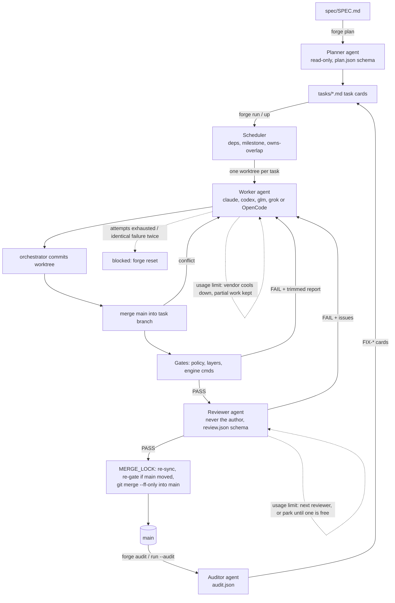

# Architecture and data flow

AgentForge is one stdlib-only Python program (`bin/forge`) plus a project template. It
doesn't run a server or a database. All state lives in the project's git repo and in its
`.forge/` folder.



## Components (all in `bin/forge`)
| Part | Functions | Role |
|---|---|---|
| Project/config/state | `Project`, `update_state`, `set_task`, `event` | Loads `forge.toml` and keeps `.forge/state.json`, guarded by a thread lock and atomic rename. Appends to `.forge/logs/events.log`. |
| Task cards | `load_cards`, `write_card` | Parses and writes `tasks/*.md` (TOML front matter between `+++` lines). |
| Vendors | `HARNESS`, `FAMILY`, `vendor_names`, `harness_of`, `family_of`, `glm_key`, `glm_env`, `read_env_file`, `redact` | `claude` and `glm` both run Claude Code; `codex` runs Codex CLI; `grok` runs Grok Build; every `[agents.<name>]` table with `harness = "opencode"` adds an OpenCode vendor. `glm_env` builds a private child environment for Z.ai (see `docs/VENDORS.md`). |
| OpenCode | `opencode_cmd`, `sandbox_wrap`, `opencode_permissions`, `claude_bash_denies`, `parse_opencode_output` | `opencode run --format json` inside bubblewrap, permissions via `OPENCODE_PERMISSION`, JSON-event parsing (text, cost, tokens, errors). |
| Shared pools | `pool_of`, `pool_append`, `pool_entries`, `pool_spend`, `pool_until` | Machine-wide JSONL ledger per `[pools.<name>]` (spend, plan-level cooldowns, clears), guarded by `flock`, so several projects share one plan's allowance. |
| Limits | `detect_limit`, `api_retry_stop`, `rate_limit_events`, `overage_in_use`, `limit_reset_time`, `set_cooldown`, `disable_vendor`, `cooldown_until`, `available`, `allowance_until`, `record_spend` | Recognise usage/rate limits (text, Claude Code `rate_limit_event`, Z.ai 429/13xx codes, OpenCode error events) and paid Claude overage; a hit pauses that vendor until its reset (cooldown in memory and `state.json`) without charging the attempt; login problems disable the vendor for the process; `monthly_usd` allowance windows pause a vendor before the provider does. See `docs/LIMITS.md`. |
| Vendor choice | `pick_worker`, `review_pool`, `review_candidates`, `cross_reviewer`, `pick_reviewer`, `other` | Round-robin over free workers, rotation on retry, and cross review that prefers another model family and another harness, skips cooling vendors and never picks the author. |
| Agent runner | `build_cmd`, `grok_cmd`, `opencode_cmd`, `run_agent` | Builds the `claude -p` (claude/glm), `codex exec`, `grok` or `opencode run` command line, applies timeouts (kills the whole process group), records every prompt, log, and output, tracks spend, and enforces the global caps. |
| Gates | `gate_policy`, `doc_coverage`, `gd_untyped`, `gate_layers`, `run_gates` | Built-in checks first (anti-cheat, scope, size, docs, typing, architecture layers), then the engine's commands from `[gates.cmd]`. |
| Orchestration | `run_task`, `can_start`, `ready_tasks`, `overlaps`, `cmd_run` | Thread pool scheduler plus the per-task loop: work, gates, review, merge; limit handovers, parking (`pending_review`) and `--wait`. |
| Git | `ensure_worktree`, `commit_all`, `sync_main` | Worktree per task under `.forge/worktrees/<ID>` on branch `forge/<ID>`. |

## Design rules this enforces
- **Isolation:** parallel agents never share a checkout. The scheduler also refuses to run two
  tasks with overlapping `owns` globs at the same time, which keeps merge conflicts rare.
- **Agents never touch git history:** the orchestrator commits and merges. A worker can't
  "merge itself".
- **Objective before subjective:** cheap deterministic gates run before any reviewer tokens
  are spent.
- **Cross-vendor review:** with `reviewer = "cross"`, the reviewer is never the author and is
  preferably on a different harness: Codex reviews Claude's and GLM's work, Claude (or GLM)
  reviews Codex's. When only Claude Code vendors are available, Claude and GLM review each
  other (a different model, same tool). This lowers the chance that one model's blind spots
  get approved. Full rules: `docs/CONFIG.md` under `[agents]`.
- **Spend separation:** only real `claude` runs add to `total_usd` (the budget). glm's
  Claude Code cost estimate goes to `glm_usd_nominal`; per-vendor run counts go to
  `vendor_runs`.
- **No paid overage by default:** a claude run whose stream reports `isUsingOverage` is
  killed and treated as a usage limit unless `[agents.claude] allow_overage = true`.
- **Serialized merges:** one merge at a time (`MERGE_LOCK`). If `main` moved after review,
  the gates run again on the merged result before the fast-forward.
- **Milestone discipline:** with `strict_milestones`, no card from milestone N+1 starts until
  every card of milestone N is `done`.

## Files written at runtime
```
.forge/state.json                      task statuses, attempts, history, total_usd, agent_runs,
                                       cooldowns, spend_log, vendor_usd, vendor_runs,
                                       vendor_tokens, glm_usd_nominal, grok_usd_reported
.forge/logs/events.log                 human-readable timeline (what `forge up` tails)
.forge/logs/<TAG>-<role>-<vendor>-<ts>.prompt.md   exact prompt sent
.forge/logs/<TAG>-<role>-<vendor>-<ts>.log         raw agent stdout/stderr (claude stream-json / codex JSONL)
.forge/logs/<TAG>-<role>-<vendor>-<ts>.out         codex/mock final message (-o)
.forge/logs/<TAG>-review-<attempt>.json            parsed reviewer verdict
.forge/worktrees/<ID>/                 live worktree (removed after merge)
.forge/audit-<ts>.md                   auditor reports
docs/SPEC_ISSUES.md                    planner-reported spec contradictions/ambiguities
```
`<TAG>` is the task ID, or `plan` / `audit`.

Outside the project, pooled vendors write `~/.local/state/agentforge/pools/<pool>.jsonl`
(`$FORGE_POOL_DIR` or `$XDG_STATE_HOME` override the location), and glm runs use
`~/.config/agentforge/glm-claude` as their Claude Code config dir.
